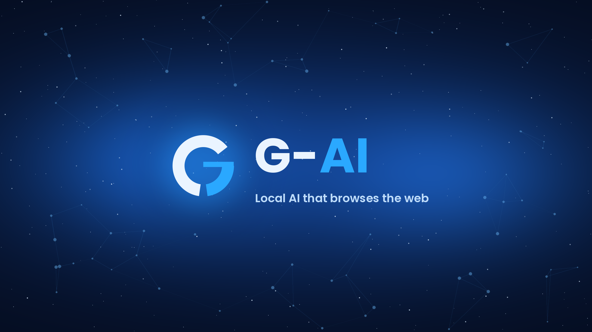

<h2>Your Local AI. Your Rules.</h2>

 

Welcome to G-AI! 🚀

G-AI is my project to create a local AI assistant that can do many of the things you'd expect from something like Grok.

Basically, it's like having your own AI assistant without paying for an expensive subscription.

And right now, it's completely FREE!

 
 

<h1>✨ WHAT IS G-AI?</h1>

 

The idea behind G-AI is pretty simple: I want to make an AI that people can actually use without having to pay a bunch of money.

It runs locally and has its own abilities to make it more than just a basic chatbot.

I'm still working on it, so expect things to change and improve over time!

 
 

<h1>💸 WILL G-AI ALWAYS BE FREE?</h1>

 

<h2>THE CORE AI? YES.</h2>

🧠 Local AI and its abilities — FREE FOREVER

⚙️ Core features — FREE FOREVER

🖥️ Future G-AI desktop — May cost money

🤝 Project Buddies extras — May cost money

 

Eventually, I want to give G-AI its own desktop environment. That takes time and money to build, which is where Project Buddies comes in.

But don't worry, I'm not planning on putting the actual local AI behind a paywall.

 
 

<h1>🔮 WHAT'S COMING?</h1>

 

One of my biggest plans is to eventually give G-AI its own desktop.

I think it'd be really cool to have an entire desktop experience built around G-AI instead of just opening up a chatbot.

There's still a lot to do, but that's the goal!

 
 

<h1>🐛 FOUND A BUG? HAVE A SUGGESTION?</h1>

 

<h2>PLEASE OPEN AN ISSUE!</h2>

Seriously! If something isn't working, you have an idea for a feature, or you just want to suggest something, open an issue!

 

<h2>📅 MY G-AI BOT CHECKS ISSUES EVERY SUNDAY!</h2>

So don't be shy about leaving feedback. I actually want to know what people think and what needs fixing.

 
 

<h1>❤️ THANKS FOR CHECKING OUT G-AI!</h1>

 

Whether you're using it, helping out, reporting bugs, or just checking out the project, thanks for being here!

I'm just getting started, and there's a lot more I want to do with this project.

 

<h2>THANKS FOR BEING PART OF G-AI! 🚀</h2>

